# Flow

```mermaid
flowchart TB
    A["Customer agent's request"] --> A1{"agent linked to a customer contract"}
    A1 -- No --> Z1(["refuse: catalog only, no prices"])
    A1 -- Yes --> A2{"request complete: product, quantity, date"}
    A2 -- No --> Q1["prompt the buyer: clarify product, quantity or date"]
    Q1 --> A
    A2 -- Yes --> A3["Aimo agent: shortlist from catalog, then price and availability for the shortlist only"]
    A3 --> A4{"price and availability service answered"}
    A4 -- No --> Z2(["retry later, tell buyer nothing was ordered"])
    A4 -- Yes --> B{"all stocks are available"}
    B -- Yes --> C{"delivered by requested date"}
    B -- No --> D{"part of the quantity available"}
    C -- Yes --> P["offer good / better / best at fixed contract price, flagging any missed buyer preference"]
    C -- No --> F["propose a later delivery date"]
    D -- Yes --> I["offer available part and propose substitute for the rest"]
    D -- No --> U
    I --> U{"buyer's purpose known: what the product is used for, e.g. coffee, baking, sauces"}
    U -- No --> Q2["prompt the buyer: what is the product used for"]
    Q2 --> U
    U -- Yes --> J{"substitute available that suits that purpose and is safe for allergens"}
    J -- Yes --> K["propose substitutes ranked good / better / best by fit to the purpose, with the reason"]
    J -- No --> L{"later delivery date possible"}
    L -- Yes --> F
    L -- No --> M(["tell buyer it cannot be fulfilled and why"])
    K --> S{"substitute meets the company mandate: required tags, banned allergens"}
    S -- Yes --> P
    S -- No --> L
    F --> P
    P --> IN{"prompt the buyer: pick an offer or order nothing"}
    IN -- No --> Z3(["show options only, no order"])
    IN -- Yes --> E{"order total within the agent's purchase limit"}
    E -- Yes --> R{"price and stock unchanged at placement"}
    E -- No --> HL["hold as pending approval: the agent does not place it, and shows the human the total, the limit and why"]
    HL --> H{"prompt the buyer: approve, or reject with a reason"}
    H -- Yes --> RA{"price and stock unchanged at approval"}
    RA -- Yes --> G
    RA -- "only price changed" --> H
    RA -- "stock short" --> ST["order closed: tell the buyer what ran out, keep their request and answers"]
    ST --> B
    H -- No --> N(["reject and record the reason"])
    R -- Yes --> G["place order at fixed price"]
    R -- No --> P
    G --> O(["send confirmation and decision record"])
    G -. "buyer asks to cancel or replace" .-> X{"order already shipped"}
    HL -. "buyer asks to cancel or replace" .-> X
    X -- Yes --> X1(["too late: contact Valio Aimo customer service"])
    X -- No --> XA{"order approved by a human"}
    XA -- No --> XC(["cancel with the buyer's reason"])
    XA -- Yes --> XR{"replacing it with a new placed or approved order the buyer asked for"}
    XR -- Yes --> XC
    XR -- No --> XH{"prompt the human: confirm the cancel"}
    XH -- Yes --> XC
    XH -- No --> XK(["order stands"])

    classDef customer fill:#e8f1ff,stroke:#3b6fd8
    classDef aimo fill:#e9f7ee,stroke:#2f9e5b
    classDef human fill:#fff4e0,stroke:#d08a12
    class A,A1,A2,E,S customer
    class A3,A4,B,C,D,U,J,L,P,I,K,F,R,RA,ST,G,HL,X,XA,XR aimo
    class Q1,Q2,IN,H,XH human

```

Orange steps need the buyer. The agent asks them with the host's interactive question tool
(`AskUserQuestion` in Claude Code, MCP elicitation or a structured choice elsewhere): one question,
two to four options with the recommended one first, and a free-text answer for anything else. It
does not print a question as plain text and wait. Plain text with lettered options is only the
fallback for a host that has no such tool. The skill's "Asking the buyer" section has the details.

Approval (`H`) is only for orders whose total is over the agent's purchase limit. A substitute or a
later date is the buyer's choice in the offer prompt (`IN`), not an approval. A substitute that misses
one of the buyer's own preferences can be ordered once the buyer picks it, and the order records the
miss. A substitute that breaks the company mandate (required tags or banned allergens set in
`API_REQUIRED_TAGS` and `API_BANNED_ALLERGENS`) is never offered, and the server refuses it.

Approval re-checks price and stock (`RA`). If only the price moved, the buyer is asked again with the
new total. If stock no longer covers the order, the server closes it, the agent tells the buyer what
ran out, and the flow re-runs from the availability check (`B`) with the same request, requirements,
purpose and date, so the buyer is not asked again for answers they already gave.

On MCP the approval prompt (`H`) is the server's own elicitation form, shown by the host: the agent
calls `approve_order` right after the order comes back pending (or `reject_order` when the buyer
says reject), the server runs `RA` for an approval, and the human picks approve or reject and
writes the reason in the form (optional for an approval). A price change is shown in that same form, so
`RA -- "only price changed" --> H` is one prompt, not two. Declining or dismissing the form leaves
the order pending (`decision_cancelled`); only a reject chosen in the form takes the `H -- No` path. Over
REST the agent asks with its own dialog and confirms a changed price with `expected_total`.

**Cancel until shipped.** After an order is placed (`G`) or held for approval (`HL`), the buyer can ask
the agent to cancel or replace it. A shipped order cannot be cancelled (`already_shipped`): the buyer
contacts Valio Aimo customer service. A `placed` or `pending_approval` order is cancelled by the agent
with the buyer's reason. An `approved` order undoes a human decision, so on MCP `cancel_order` shows
the human the server's confirm form (`XH`); declining leaves the order as it was (`cancel_declined`).
The exception is a replacement the buyer asked for (`XR`): the agent places the new order first, and
once it is `placed` or `approved` cancels the old one with `replaced_by`, with no form. While the new
order is still pending approval, the old one is kept (`replacement_pending`). Over REST there is no
form, and the cancel is recorded as `confirmed_via: rest`. Shipping is a wholesaler event; in the
demo the ops route `POST /api/orders/{id}/ship` stands in for it.
