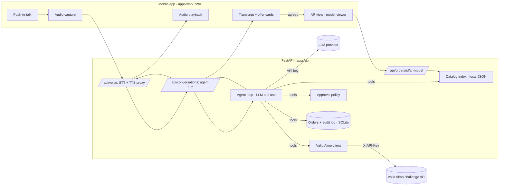

# Voice ordering mobile app with AR space preview

Outcome, non-goals and acceptance criteria live in [`docs/project-goals.md`](../../docs/project-goals.md).
This plan only sequences the work.

## Architecture

## Key decisions (defaults; change before Phase 4 if needed)

| Decision | Default | Alternative | Why the default |
|---|---|---|---|
| Mobile runtime | Mobile-first **PWA** in existing `apps/web` | Expo / React Native app | Reuses scaffold; AR via native Scene Viewer / AR Quick Look through `<model-viewer>` works on both iOS and Android without app-store builds. Expo only pays off if offline or deep native AR is required. |
| AR rendering | `<model-viewer>` with BE-generated glTF box stack at true scale | WebXR hit-test (Android only), ViroReact | Only option covering iOS + Android from a web app. |
| LLM | `kimi-k3-1-pro` on Verda inference (OpenAI-compatible chat completions) via BE, tool calling, streaming | — | Provided by the team. Use the `openai` SDK with `base_url=$OPENAI_COMPATIBLE_URL/v1`. Reply text may arrive in `reasoning_content` when `content` is empty. |
| STT / TTS | BE-proxied provider (keys stay server-side) | Browser Web Speech API | Consistent quality on iOS; satisfies "no secrets on device". Web Speech kept as dev fallback. |
| Persistence | SQLite (orders, sessions, audit) | Postgres | Hackathon scope; single process. |
| AR timing | Offer AR after verbal agreement, **before** order submission | After submission | Lets the buyer back out if it will not fit. |

## Phases

| # | Phase | Depends on | Status |
|---|---|---|---|
| 1 | [Backend foundation: upstream client + catalog](phase-01-backend-foundation.md) | — | done |
| 2 | [Orders, approval policy, audit trail](phase-02-orders-approval-audit.md) | 1 | done |
| 3 | [Conversational agent + voice endpoints](phase-03-agent-and-voice.md) | 1, 2 | done |
| 4 | [Mobile voice UI](phase-04-mobile-voice-ui.md) | 3 | removed (frontend dropped) |
| 5 | [AR space preview](phase-05-ar-space-preview.md) | 2, 4 | backend done; frontend removed |

Phases 1 → 2 → 3 are serial (shared `apps/api` modules). Phase 4 can start against a stubbed
`/api/conversations` contract once Phase 3's schema is fixed. Phase 5's BE part (glTF endpoint)
can run in parallel with Phase 4.

## Cross-cutting acceptance

- `mise run check` passes (ruff, pyright strict, oxlint, tsc, pytest).
- Demo script from `docs/project-goals.md` acceptance criteria 1–6 runs end to end on a phone.

## Risks

| Risk | Mitigation |
|---|---|
| Upstream rate limits (undisclosed) | Narrow via local catalog first; cache price/availability per (customer, products, date) for a few minutes; one batched call per turn. |
| Voice latency stacks (STT + LLM + tools + TTS) | Stream LLM output, start TTS on first sentence, cap tool rounds per turn. |
| ~18% of products lack dimensions | AR falls back to a labelled estimate from volume/weight, or hides AR with a spoken reason. |
| LLM proposes an order outside policy | Policy enforced in BE tool, never in the prompt alone. |
| Conversation diagram arrives late | Agent flow is a state field + prompt section; swap without touching tools or UI contract. |

## Direction change (2026-11-13)

The brief targets external purchasing agents, not a buyer chatbot, so `apps/web` (voice PWA and AR view) was removed. The backend core (catalog, fixed-price orders, approval policy, audit) carries forward into an MCP + REST interface for customers' agents; the voice, conversation and AR endpoints remain in `apps/api` but have no client.

## Unresolved questions

1. The conversation-flow diagram (pending from the product owner) may add states that change the `/api/conversations` response schema. `flow_state` is a `Literal` in `api/agent/state.py`; new states need a prompt line and the tool effect that enters them.

Resolved: LLM is Verda `https://inference.verda.com` with `kimi-k3-1-pro`; streaming tool calls verified live and the reference milk request ran end to end (search, quote, draft, agree, AR offer, escalation). Voice uses on-device Web Speech for now. Approve/reject stay unauthenticated for the demo and the spend threshold applies per order (both documented in `docs/backend-api.md`). Upstream base URL is `https://junction26.valioaimo.fi` (verified with `/api/ping`); spend threshold defaults to 500 EUR excl. VAT (`API_APPROVAL_SPEND_THRESHOLD_EUR`).
