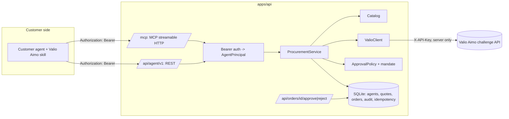

# MCP agent interface, customer skill and agent-scoped ordering

Outcome, non-goals and acceptance criteria are in [`docs/project-goals.md`](../../docs/project-goals.md).
This plan only covers the gap between the current `apps/api` and those goals, and the order of work.

## Where the code stands

| Goal | Current state | Gap |
|---|---|---|
| A1 MCP server | None. Tools exist only as LLM function-calls in `api/agent/tools.py`, bound to a conversation `Session`. | MCP transport, agent-scoped tool set. |
| A2 Structured data | `ProductOut` / `_product_summary` already carry id, name, sales unit, content per sales unit, pack, allergens, tags, reliability, CO₂. `ProductQuote` carries price and availability. | Server-side conversion from buyer amounts (litres, kg) into sales units rounded to `allowed_lot_size`. |
| A3 Quote → order at fixed price | `OrderService` re-quotes on `place` and refuses on change (`quote_changed`). The flow is `draft → agree → place`, gated by *conversation turns*. | Turns do not exist for external agents. Without a server-held quote, "stale price" has nothing to compare against. |
| A4 Agent auth | None. Every endpoint is anonymous; `customer` is one global setting. | Agent credentials mapped to a customer; per-agent order scoping. |
| A5 REST parity | REST routes exist but follow the buyer/voice lifecycle (`actor="buyer"`, session ids). | Agent REST routes over the same service as MCP. |
| B1 Upstream wrapper | Done: `ValioClient` (cache, batching ≤ `MAX_CODES_PER_CALL`), catalog index, reliability and CO₂ joins. | `customer` must become a per-call argument; the cache key must include it. |
| B2 Approval rules | Done: `ApprovalPolicy` (threshold + `within_preferences`). | Requirements were harvested from conversation search calls; needs a source for agents (quote, plus optional mandate). |
| B3 Approve / reject | Done (unauthenticated by decision). | The agent reads the outcome through its own scoped `get_order`. |
| B4 Audit trail | Done: `AuditEntry` per transition, text rendering. | No agent identity; "options considered" is whatever the model claims. |
| S1, S2 Skill | None. | Write it. |

Reusable as is: `catalog/index.py`, `valio/client.py` (one signature change), `orders/policy.py`,
`orders/store.py` (additive tables only), `OrderError` + exception handlers, the test fakes in
`tests/conftest.py`.

## Design

Agent flow: `search_products → quote (server stores quote, expiry) → place_order(quote_id, lines)
→ placed | pending_approval → get_order (status + audit)`.

### Key decisions

| Decision | Recommended | Alternative | Why |
|---|---|---|---|
| Fixed-price contract | **Server-stored quote** (`quote_id`, lines, prices, availability, requirements, `expires_at`, default 15 min). `place_order` must cite it; the server re-quotes and refuses on any change. | Agent sends expected unit prices with the order (stateless). | Stale-price refusal (AC4) needs a reference the agent cannot fabricate. "Options considered" in the audit becomes what the server actually quoted, not what the model says it looked at. One extra table. |
| Quote signing | **None for the demo.** The quote is a server-side record the agent can re-read. | HMAC-signed quote token. | A signature only matters to a third-party verifier, and there is none in the demo. Can be added later without changing the tool contract. |
| Agent lifecycle | **Skip `draft`/`agreed` for agent orders.** `place_order` lands directly in `placed` or `pending_approval`. | Keep draft → agree → place over MCP. | `agree` existed so a human heard the read-back in the voice flow. For an autonomous agent the quote is the read-back; extra round trips add failure points, not safety. `OrderStatus` is unchanged. |
| Requirements source | **Declared on `quote` and frozen on the quote record**, unioned with the agent's mandate (if set). Lines that miss them escalate. | Harvest from search filters (current session approach). | There is no session across MCP calls. Freezing at quote time means the agent cannot drop a requirement between quote and order. |
| Spend authority | **Per-agent mandate whose `spend_limit_eur` defaults to the global 500 EUR threshold**, plus optional `required_tags` / `banned_allergens`. | Global threshold only (current decision). | Answers open question 1 without reversing the recorded decision: with no per-agent value set, behaviour is identical. Needs confirmation. |
| Credentials | Opaque bearer keys (`vaa_` + 32 random bytes), SHA-256 stored, minted by a CLI task, shown once. | OAuth 2.1 resource server per the MCP auth spec. | Hackathon scope; high-entropy keys make a plain hash sufficient. OAuth is the production path and is listed as a follow-up. |
| MCP transport | Official `mcp` Python SDK (`FastMCP`), streamable HTTP mounted in the FastAPI app at `/mcp`. | stdio server; `fastapi-mcp` auto-generation. | One process and one auth path for MCP and REST. Works locally with Claude Code and remotely behind HTTPS. Auto-generating from REST would leak the buyer-flow routes. |
| Idempotency | `place_order` takes a required `client_reference`, unique per agent. | Optional header (current REST). | Agents retry on timeouts; a duplicate order is the costliest failure here. |
| Legacy voice/conversation/AR code | **Remove** (`api/agent`, `api/voice`, `routes/conversations.py`, `routes/voice.py`, `orders/footprint.py`, `orders/gltf.py`, the `openai` dependency, buyer-flow REST routes). | Keep, unused. | Goals put it out of product scope (decision 3, open question 4). Dead endpoints are attack and maintenance surface. Needs confirmation; the work is isolated in phase 5. |

## Phases

| # | Phase | Goals | Depends on | Status |
|---|---|---|---|---|
| 1 | [Agent identity and procurement core](phase-01-agent-identity-and-procurement-core.md) | A2, A3, A4, B1, B2, B4 | — | done |
| 2 | [Agent REST API](phase-02-agent-rest-api.md) | A5, B3 | 1 | done |
| 3 | [MCP server](phase-03-mcp-server.md) | A1, A4 | 1 | done |
| 4 | [Customer skill](phase-04-customer-skill.md) | S1, S2 | 1 (tool contract) | done |
| 5 | [Legacy removal, docs and demo verification](phase-05-cleanup-docs-demo.md) | AC 1–6 | 2, 3, 4 | done |

Phase 1 is serial and owns `main.py` wiring plus a shared `api/procurement/schemas.py` so the two
transports cannot drift. Phases 2, 3 and 4 then run in parallel with disjoint files
(`routes/agent.py`, `api/mcp/`, `skills/`). Phase 5 is last.

## Acceptance mapping

| AC | Proven by |
|---|---|
| 1 Reference milk request returns product, price, availability, sales-unit quantity | Phase 5 live run with Claude Code + skill; phase 3 in-process MCP client test with fakes. |
| 2 Order within authority placed autonomously | `test_procurement.py::test_place_within_limit` and the MCP flow test. |
| 3 Above threshold → `pending_approval`, reason, approve/reject visible to agent | `test_procurement.py` escalation + decide + agent `get_order`. |
| 4 Server refuses out-of-rule actions (stale price, expired quote, other agent's quote, line not in quote) | `test_procurement.py` refusal cases; same cases through MCP. |
| 5 No secrets in git; agent holds only its own key | Key hash only in SQLite; `.env.example` placeholders; `git grep` check in phase 5. |
| 6 Audit entry with agent, request, options considered, choice, reason | `test_procurement.py` audit assertions; `audit.txt` in demo. |

Cross-cutting: `mise run check` passes (ruff, pyright strict, pytest).

## Risks

| Risk | Mitigation |
|---|---|
| The challenge API may only accept known `customer` ids. | Verify with one `/api/price` call per candidate id before seeding agents; fall back to mapping every agent to `API_VALIO_CUSTOMER`. |
| Undisclosed upstream rate limits, now with several agents. | Per-agent quote budget (requests/min), max 12 products per quote, existing per-(customer, product, date) cache. |
| MCP SDK API drift (mounting, auth hooks, lifespan). | Pin the version; confirm mounting and request-context access against current SDK docs before writing phase 3. |
| LLM agents mis-convert litres to cases. | Server-side conversion in `quote` (A2) returns the computed sales-unit quantity and the arithmetic. |
| Agent under-declares requirements on `quote`. | Mandate tags apply regardless; documented residual risk (the server cannot know unstated intent). |
| Quote expiry too short for a human-in-the-loop agent. | Configurable `API_QUOTE_TTL_S`; an expired quote is refused with a clear `quote_expired` code and the agent re-quotes. |

## Resolved questions

1. Per-agent mandate: confirmed (2026-11-13). Implemented with the spend limit defaulting to the global
   threshold.
2. Legacy voice, conversation and AR code: confirmed for removal and removed in this plan. Phase 5 ran
   the removal first, so phase 1 did not need to keep the buyer flow alive.
3. Upstream customer: `junction-demo` is accepted by the challenge API (live run, 2026-11-13).

## Unresolved questions

1. Demo host: the live check used a scripted MCP client against the local server. An LLM-driven run in
   Claude Code still needs a person to add the key and drive the session; a claude.ai or Claude
   Desktop connector needs a hosted HTTPS URL plus `API_MCP_ALLOWED_HOSTS`.
2. Goal B5 (complete order record: request text and reason on the order itself, approver identity,
   chat) was added to the goals after this plan. The request and reason are in the audit trail but
   not yet on the `Order` record.
