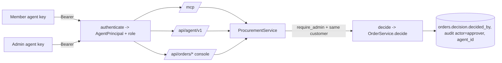

# Member and admin agent keys, admin-only approval over MCP and REST

## Outcome

A customer company (one upstream `customer` id) can be issued two kinds of agent key:

- **member**: what every key does today. Search, quote, place orders, read its own orders and audit.
  Orders that hit a limit become `pending_approval`, and a member cannot change that.
- **admin**: everything a member can do, plus seeing the company's orders and approving or rejecting
  the company's `pending_approval` orders. This works through the same skill and MCP endpoint, and
  through REST.

The role is set when the key is issued (`mise run agent:create -- --role admin`), stored server-side,
and checked on every call. A member cannot get admin rights, whatever its agent attempts.

## Non-goals

- Human user accounts, passwords, SSO or OAuth. A key still stands for "a person's agent". OAuth 2.1
  remains the production path (recorded decision).
- Self-service key issuing over the API. Keys come from the CLI, as they do today.
- Per-role spend limits. The spend limit stays a per-key mandate, and admins can carry one too.
- The order console UI (F1–F4). This plan only gives it an authenticated approval API to call.

## Where the code stands

| Concern | Today | Gap |
|---|---|---|
| Credential | `agents` row: `id, name, customer, key_hash, mandate, disabled` (`orders/store.py:42`). | No role. |
| Principal | `AgentPrincipal(agent_id, name, customer, mandate, created_at)` (`agents/models.py`). | No role. |
| Order scope | `_agent_order` returns 404 unless `order.agent_id == agent.agent_id` (`procurement/service.py:284`). | No company-wide view. |
| Approve / reject | `OrderService.decide` behind **unauthenticated** `POST /api/orders/{id}/approve|reject` (`routes/orders.py`). | Anyone can approve. The actor is a bare `"approver"` with no identity. |
| MCP | 8 tools, all available to every key; auth via `AgentAuthASGI` (`mcp/auth.py`). | No approval tools, no per-role tool listing. |
| Decision record | `OrderDecision(approved, reason, at)`. | No `decided_by` (B5 asks for "who decided"). |

## Design

Approval flow: `member place_order → pending_approval → admin list_pending_approvals → admin
approve_order(order_id, reason) → member get_order sees approved + who decided`.

### Key decisions

| Decision | Recommended | Alternative | Why |
|---|---|---|---|
| Where the role lives | **`role` column on the existing `agents` row** (`member` default, `admin`). A key is the identity. | Separate `users` table with keys linked to it. | Smallest change that meets the need. No user concept exists anywhere else. Existing keys become members on migration, so nothing changes for them. |
| Key format | **Unchanged `vaa_` prefix.** The role is read from the DB, never from the token. | `vaa_adm_` prefix for admin keys. | A prefix speeds up triage of leaked keys but invites code that trusts it. Can be added later without a contract change. |
| Admin's read scope | **Company scope**: an admin can `get_order` and audit any order of its `customer`, and `list_orders(scope="company")`. Members stay on their own orders. | Admin sees only the pending queue. | An approver needs the order's record and audit to decide, which is goal B5 and the brief's audit-trail direction. Other customers' orders still return 404, so ids cannot be probed. |
| Self-approval | **Refused** (`403 self_approval_forbidden`): no key can decide an order it placed itself. | Allow it, and record it in the audit. | Otherwise an admin's LLM can place an over-limit order and approve it in the same loop, and the spend limit stops meaning anything. Cost: a company with one admin needs a second admin key (or a member key) for that admin's over-limit orders. **Needs confirmation.** |
| Approval surface | **MCP tools `list_pending_approvals`, `approve_order`, `reject_order`, plus REST twins under `/api/agent/v1`.** Hidden from members in `tools/list` *and* refused server-side. | Only enforce on call, list to everyone. | Hiding tools keeps member agents from planning around tools they cannot use. The service check is the real control, and hiding is UX. |
| Legacy console routes `/api/orders/{id}/approve|reject` | **Require an admin key** and route through the same service method. | Leave them unauthenticated. | Leaving them open makes the admin role pointless. This **reverses the recorded decision "approval endpoints are unauthenticated for the demo"**, which the request implies. Goals doc to be updated. |
| Human in the loop for admin approvals | `approve_order` / `reject_order` are annotated `destructiveHint=True` and require a non-empty `reason`. The skill tells the agent to decide only on the human's explicit instruction, quoting the order's approval reasons first. | Trust the LLM. | The approver is now an LLM holding an admin key, so a prompt-injected product text could ask it to approve. Destructive annotations make Claude Code and Desktop ask for confirmation. The server cannot prove a human said yes; that residual risk is documented. |
| Error codes | Member calling an admin op: **403 `forbidden`**. Admin on another customer's order: **404 `order_not_found`**. Unknown or disabled key: 401 (unchanged). | 404 for everything. | A member knows its own role (from `whoami`), so 403 leaks nothing and is clearer to the agent. Cross-tenant stays 404 so ids cannot be probed. |

### Extension trace

The next likely variant is a third role, for example a `viewer` that can read company orders but not
place them, or an OAuth-issued principal. The stable contract is `AgentPrincipal.role` plus two
service guards: `require_admin` (public so the REST idempotency replay can check it first) and `_visible_order(agent, order_id)`. A new role changes the
`Role` literal and those two guards. Transports do not change, because MCP tool filtering reads a
single `ADMIN_TOOLS` set. Phase 2's tests cover each guard per role, which proves this. No role or
permission registry is introduced.

## Phases

| # | Phase | Depends on | Status |
|---|---|---|---|
| 1 | [Role on agent keys, migration and CLI](phase-01-role-on-agent-keys.md) | — | completed |
| 2 | [Authorization and approval in the procurement service](phase-02-authorization-and-approval-service.md) | 1 | completed |
| 3 | [Transports: REST, console routes and MCP tools](phase-03-transports-rest-console-mcp.md) | 2 | completed |
| 4 | [Skill, docs and live check](phase-04-skill-docs-live-check.md) | 3 | completed |

Phases run in order: each one changes contracts the next depends on, and phases 2 and 3 share
`procurement/schemas.py`.

## Acceptance criteria

1. `mise run agent:create -- --name ops --customer X --role admin` prints an admin key once, and
   `--role` defaults to `member`. `agent:list` shows each key's role, never the key itself.
2. An existing database with agents and no `role` column opens without error, and every existing
   key resolves as `member`.
3. `whoami` returns `role` and, for an admin, notes that it can approve the company's escalated orders.
4. A member key gets `403 forbidden` from `approve_order`, `reject_order`, `list_pending_approvals`
   and `list_orders(scope="company")` over both MCP and REST. Member `tools/list` does not include
   the three admin tools.
5. An admin key of the same customer can list pending approvals, approve or reject with a reason,
   and the member's `get_order` then shows the new status with `decision.decided_by` naming the admin.
6. An admin cannot decide another customer's order (404) or an order its own key placed
   (`403 self_approval_forbidden`).
7. `POST /api/orders/{id}/approve|reject` without a key returns 401, with a member key returns 403,
   and with an admin key behaves as before, except that `reason` is now required (empty or missing
   gives 422).
8. The audit trail records each decision as actor `approver` with the deciding key's `agent_id`, name
   and role.
9. `mise run check` passes (ruff, pyright strict, pytest).

## Result

All four phases are implemented and `mise run check` passes (82 tests). Live check:
[`demo-261113-2255-agent-roles.md`](../reports/demo-261113-2255-agent-roles.md). The SDK request context
is available in `list_tools`, so admin tools are hidden from member keys.

## Risks

| Risk | Mitigation |
|---|---|
| The FastMCP `list_tools` override cannot see the HTTP request (it does have a request context in 1.30, but this is unverified). | Phase 3 checks `self.get_context().request_context.request` in `list_tools` first. If it is unavailable, list every tool and rely on the service's 403. The documented fallback is still secure. |
| Local `app.sqlite3` with live agents gets migrated. | Back up `apps/api/data/app.sqlite3` before the first run (repo rule). The migration only adds a column with a default, so it is reversible by restoring the copy. |
| The demo company has only one admin, so self-approval refusal blocks that admin's own escalated orders. | The demo script issues one member and one admin key. Orders are placed with the member key and approved with the admin key. |
| An admin LLM approves without the human. | Destructive annotation, required reason, skill rule, and the audit shows which key decided. Documented as residual risk. |

## Unresolved questions

1. Self-approval: implemented as refused (the recommendation), pending confirmation. Allowing it changes
   one guard in `ProcurementService.decide` and one test per transport.
2. Should the future order console use an admin agent key (this plan), or a separate staff login
   for Valio Aimo staff? This depends on open question 3 in `docs/project-goals.md`.
